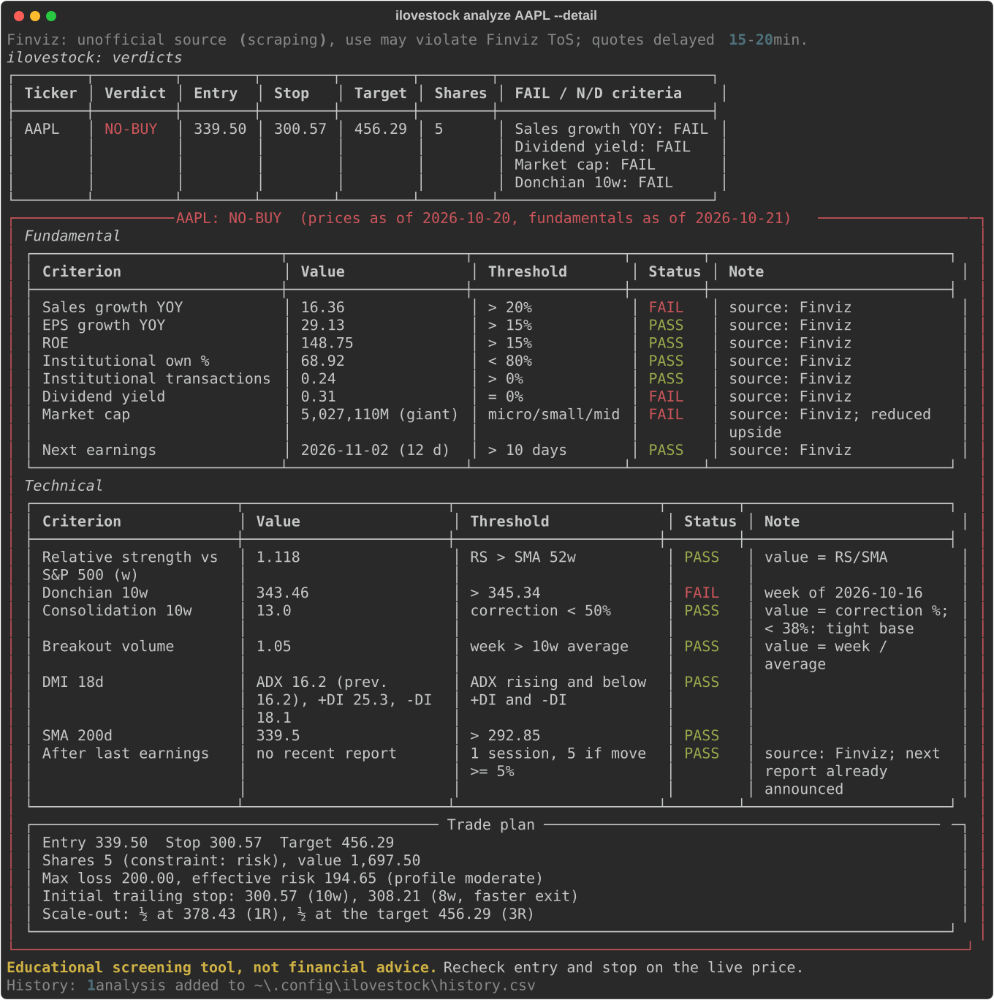

<div align="center">

# iLoveStock

**Rule-based BUY / NO-BUY screening and trade plans for US stocks**

[](https://github.com/yintong-zhou/ilovestock/actions/workflows/ci.yml)

[](LICENSE)

[Overview](#overview) • [Getting started](#getting-started) • [Usage](#usage) • [How the verdict works](#how-the-verdict-works) • [Data and limits](#data-and-limits) • [Development](#development)

</div>

> [!WARNING]
> ilovestock is an **educational screening tool, not financial advice**. A BUY verdict means "every rule of the method passed on the data available", not "you should buy". Data comes from unofficial sources and can be wrong, late or missing. Always recheck entry and stop on the live price before trading.

## Overview

Applying a stock-picking method by hand is slow: about seven fundamental filters, four technical indicators on mixed timeframes, the distance to the next earnings report and position sizing, for every ticker. Common screeners lack some of the indicators (Donchian 10 weeks, ADX 18 days), and charting tools don't compute stops or share counts.

ilovestock does that work for you. For each US ticker (NASDAQ, NYSE, AMEX), it:

1. Downloads prices and financials, with a daily disk cache.
2. Checks each fundamental, earnings and technical criterion against fixed thresholds.
3. Builds a trade plan: entry, technical stop, take profit in R multiples, number of shares.
4. Returns **BUY** only if everything passes. Otherwise it returns **NO-BUY** and lists the criteria that failed or had no data. Prices quoted in a currency other than USD are rejected.

Example: `ilovestock analyze AAPL --detail` (data as of 2026-10-20):



### Features

- **Per-criterion results.** Each criterion reports its value, threshold and status: `PASS`, `FAIL` or `N/D`. Missing data is always `N/D` and never counts as a pass.
- **Fundamental analysis.** Sales and EPS growth, ROE, institutional ownership and transactions, dividend yield, market cap band.
- **Earnings check.** No entry when the next earnings report is 10 days away or less.
- **Four technical confirmations.** Relative strength vs the S&P 500, Donchian breakout, DMI/ADX and SMA 200, all with fixed parameters.
- **Trade plan.** Entry, technical stop, take profit in R multiples, and position sizing capped by maximum exposure.
- **Report files.** Markdown, CSV and JSON export, each with data date, sources and disclaimer.
- **Flexible input.** Tickers on the command line, a watchlist file and a Finviz screener URL can be combined; duplicates are removed.
- **Layered config.** Course defaults, then a TOML file, then CLI options.

## Getting started

### Prerequisites

- Python 3.11 or later
- Git

### Installation

ilovestock is not on PyPI yet. Install it from source:

```bash
git clone https://github.com/yintong-zhou/ilovestock.git
cd ilovestock
python -m venv .venv
source .venv/bin/activate   # Windows: .venv\Scripts\activate
pip install -e .
```

> [!CAUTION]
> Fundamentals come from Finviz through scraping, and that may violate Finviz's terms of service. Finviz quotes are also delayed 15–20 minutes. Use ilovestock only if you accept that.

Check that the CLI works:

```bash
ilovestock --help
```

## Usage

### Analyze tickers

```bash
# One or more tickers
ilovestock analyze HZO NIO

# Per-criterion detail and the full trade plan for each ticker
ilovestock analyze HZO --detail

# Combine inputs: tickers + watchlist + Finviz screener
ilovestock analyze HZO --watchlist my_list.txt --finviz-url "https://finviz.com/screener.ashx?v=111&f=cap_small"

# Override risk parameters for this run only
ilovestock analyze HZO --capital 15000 --risk-pct 0.5 --r-multiple 4

# Save the results as report files
ilovestock analyze HZO NIO --export md,csv,json
```

A watchlist is a text or CSV file with one ticker per line. Lines starting with `#` and a `Ticker` / `Symbol` header are ignored.

| Option | Meaning |
|---|---|
| `TICKER ...` | One or more tickers |
| `--watchlist FILE` | One ticker per line (txt/csv) |
| `--finviz-url URL` | Import tickers from a Finviz screener URL copied from the site |
| `--capital N` | Equity portfolio capital |
| `--risk-pct N` | Max loss per trade, % of capital (above 2 is rejected) |
| `--max-position-pct N` | Max weight per stock, % of capital |
| `--r-multiple N` | Take profit as a multiple of R (below 2, the trade is discarded) |
| `--growth-basis yoy\|qoq` | Growth vs the same quarter last year (Finviz, default), or vs the previous quarter (Yahoo) |
| `--entry-mode breakout\|pullback\|restart` | Entry point used for the trade plan |
| `--allow-missing` | `N/D` fundamental criteria don't block: the verdict is **BUY\*** (incomplete data) instead of BUY, with the `N/D` criteria listed |
| `--detail` | Per-criterion panel for each ticker |
| `--export md,csv,json` | Write report files (any combination of the three formats) |
| `--out-dir DIR` | Report directory (default `reports`) |
| `--config FILE` | Use a different config file |

### Report files

`--export` writes one folder per run, `reports/YYYY-MM-DD_HHMM/`:

| File | Content |
|---|---|
| `report.md` | Summary table, per-criterion tables and trade plan for each ticker |
| `results.csv` | One row per ticker: verdict, trade plan, status and value of each criterion. Header lines start with `#` (`pandas.read_csv(path, comment="#")`) |
| `results.json` | Everything above plus the effective config, for scripts |

Every file states the data date, the data sources and the disclaimer.

### Configuration

```bash
ilovestock config init    # write the config file with course defaults
ilovestock config show    # print the effective config (defaults + file)
ilovestock config path    # print the config file location
```

The config file is `~/.config/ilovestock/config.toml`. CLI options override the file, and the file overrides the course defaults:

```toml
[portfolio]
capital = 20000          # equity portfolio capital
risk_pct = 1.0           # max loss per trade (%); above 2 -> rejected
max_position_pct = 10    # max weight per stock (%)

[plan]
r_multiple = 3           # take profit in R; below 2 -> trade discarded
entry_mode = "breakout"  # breakout | pullback | restart

[fundamental]
growth_basis = "yoy"     # yoy (Finviz) | qoq (Yahoo)
sales_growth_min = 20
eps_growth_min = 15
roe_min = 15
institutional_own_max = 80

[market_cap]             # band upper bounds, millions USD
nano_max = 50
micro_max = 300
small_max = 2000
mid_max = 10000
large_max = 200000
```

> [!IMPORTANT]
> Technical indicator parameters are fixed constants on purpose: they are not in the config and have no options. The method treats tuning them case by case as a mistake.

## Web app

A local web app on the same core, for this computer only.

```bash
cd web && npm install && npm run build && cd ..   # once, and after frontend changes
ilovestock serve                                   # http://127.0.0.1:8000
```

- **PIN.** The first `ilovestock serve` asks you to set a PIN (4 to 8 digits) in the terminal, never in the browser: no other program on this computer can claim the app first. It is stored hashed in `~/.config/ilovestock/web_pin.json`, never in clear. After 5 wrong attempts, the next ones wait 30 seconds. Forgot it? Run `ilovestock pin reset`, then `ilovestock serve` again.
- **Pages.** Dashboard (statistics of the latest analysis in this session), Portfolio (planned for phase 2), Analysis (same rules and trade plan as the CLI), Settings (PIN and the same config file as the CLI).

> [!IMPORTANT]
> The server listens on `127.0.0.1` only. The PIN is a lock for this computer, not real authentication: do not expose the app on a network.

## How the verdict works

**BUY** requires all of the following. Anything else is **NO-BUY**, with the reasons listed. The only exception is `--allow-missing`: if every criterion with data passes and some fundamentals are `N/D`, the verdict is **BUY\*** (incomplete data), never a plain BUY.

### Fundamental

| Criterion | Threshold |
|---|---|
| Sales growth | > 20% |
| EPS growth | > 15% (`N/D` if the comparison quarter is ≤ 0) |
| ROE | > 15% |
| Institutional ownership | < 80% |
| Institutional transactions | > 0% |
| Dividend yield (last 12 months) | = 0 |
| Market cap | micro, small or mid |
| Next earnings | more than 10 days away |

### Technical (fixed parameters)

| Indicator | Timeframe | Condition |
|---|---|---|
| Relative strength vs S&P 500 | weekly | RS above its 52-week SMA |
| Donchian channel, 10 weeks | weekly | Price above the highest high of the 10 previous weeks |
| DMI, 18 days, Wilder smoothing | daily | ADX rising and below both +DI and −DI |
| SMA 200 | daily | Price above the SMA |

### Trade plan

- **Entry**: `breakout` buys at the last close. `pullback` uses the upper Donchian band. `restart` uses the previous week's high.
- **Stop**: the lowest low of the previous 10 weeks. It is a technical stop, not a monetary one.
- **Take profit**: `entry + r_multiple × (entry − stop)`. If `r_multiple` is below 2, the trade is discarded.
- **Shares**: `floor(capital × risk_pct / (entry − stop))`, reduced if the position would exceed `max_position_pct`. The output says which of the two limits set the share count.
- **For information only**: initial trailing stops (Donchian 10 and 8 weeks), a scale-out hint (½ at 1R, ½ above 3R), how deep the consolidation corrected, and the breakout volume.

## Data and limits

| Data | Source |
|---|---|
| Sales and EPS growth (YoY), ROE, market cap, dividend yield, next earnings date, institutional ownership and transactions | Finviz via `finviz`; Yahoo Finance as fallback for each missing field |
| Daily adjusted prices, dividend history, S&P 500 (`^GSPC`) | Yahoo Finance via `yfinance` (Finviz has no price history) |
| Quarterly sales and EPS (for `--growth-basis qoq`) | Yahoo Finance via `yfinance` |
| Candidate tickers | Finviz screener URL |

Each criterion's note shows where its value came from (`source: Finviz` or `source: Yahoo`).

> [!NOTE]
> - Neither source is official. Either can block requests or change its format without notice. Prices and fundamentals are cached for one day in `~/.cache/ilovestock`.
> - Finviz "Sales Q/Q" and "EPS Q/Q" compare with the same quarter last year, so the default growth basis is `yoy`. The course defines growth vs the previous quarter: use `--growth-basis qoq` to compute it from Yahoo quarters (usually only 4–5 are available).
> - Finviz shows the earnings date without a year, and keeps the last report date until the next one is announced. A past date is ignored and Yahoo's date is used instead.
> - Finviz shows `-` for both "no dividend" and "missing". In that case the dividend yield is computed from Yahoo's dividend history.
> - The `finviz` 2.0.0 screener no longer parses the current Finviz site, so ilovestock reads ticker links from the screener pages itself.
> - The method uses end-of-day data. Recheck prices before acting.

## Development

```bash
pip install -e ".[dev]"

pytest -m "not slow"     # offline tests on recorded fixtures
ruff check .
ruff format --check .
```

Frontend (React + Vite + Tailwind, in `web/`):

```bash
ilovestock serve          # API on :8000
cd web && npm run dev     # http://localhost:5173, /api proxied to :8000
npm run lint
npm run build
```

- Default tests never touch the network. They run on real responses recorded in `tests/fixtures/`.
- Tests marked `slow` hit live Finviz to detect page changes. Run them on purpose with `pytest -m slow`.
- Indicators are checked against TA-Lib, which is a dev dependency.
- To re-record fixtures (this uses the network): `python execution/record_fixtures.py [TICKER] [FINVIZ_URL]`.
- Project rules and release steps: [CONTRIBUTING.md](CONTRIBUTING.md).

Project layout:

```text
src/ilovestock/
  cli.py          Typer commands (thin layer, no business rules)
  analysis.py     one ticker end to end: data -> criteria -> plan -> verdict
  config.py       TOML defaults, file and CLI overrides
  indicators.py   SMA, Donchian, DMI/ADX, relative strength (pure functions)
  rules/          fundamental, technical, earnings, trade plan, verdict
  providers/      yfinance, Finviz adapter, disk cache
  report.py       Rich terminal output
  export.py       Markdown, CSV and JSON report files
  api/            FastAPI app and PIN gate for the web app
tests/            offline tests and recorded fixtures
web/              React frontend
```

### Roadmap

- First public release on PyPI
- Phase 2: managing open positions (hold/sell, trailing stop, sector cap)
